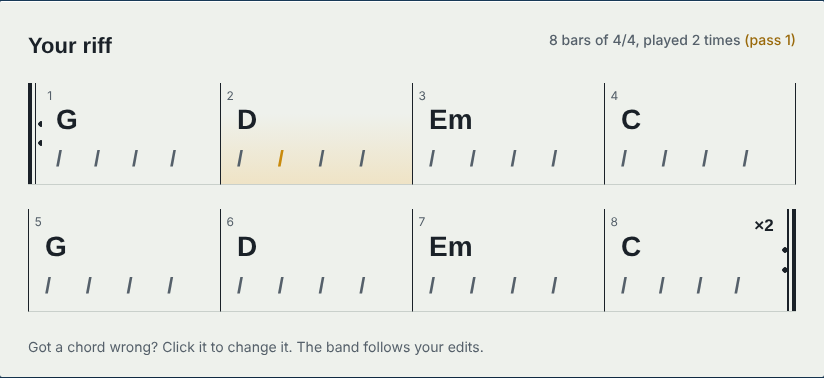

# RiffBack

Play a guitar riff into your computer and get a drummer, a bassist and a keys player to jam with.
RiffBack works out the tempo, key and chords of what you played, writes a backing track around it,
plays it back in the browser with your recording, and exports it as MIDI to drag into Ableton Live.



## What it does

1. **Record** your riff straight from an audio interface (or upload a WAV). No click track needed.
2. **Analyse** it: tempo, beat grid, key, tuning, and one chord per half bar.
3. **Edit** any chord the detector got wrong on a lead-sheet style chord chart.
4. **Arrange** a band: four drum styles, four bass styles, sustained keys with voice leading.
5. **Preview** your own recording playing along with the band, live in the browser.
6. **Export** the parts as a type-1 MIDI file (all parts, or drums, bass and keys separately).

## Tech stack

| Layer | Tools |
| --- | --- |
| Signal processing | Python, NumPy, SciPy (no audio libraries: every step is implemented here) |
| API | FastAPI, Pydantic |
| Frontend | React, TypeScript, Vite, Web Audio API (AudioWorklet recording, synthesised preview) |
| Testing | pytest (51 tests, including synthesised guitar audio), Vitest |
| Tooling | Ruff, GitHub Actions CI, Docker |

## How the analysis works

All of this lives in [`backend/riffback/analysis.py`](backend/riffback/analysis.py).

- **Onsets.** A short-time Fourier transform turns the audio into a spectrogram. *Spectral flux* (how
  much new energy appears in each frame) spikes every time you pick or strum.
- **Tempo.** Autocorrelating the onset signal shows which time gaps repeat. Gaps of 2 and 4 beats are
  added in, and a prior around 100 BPM breaks the classic "is it 70 or 140?" tie. If it still guesses
  half or double, the app has a one-click fix that re-runs the analysis with a tempo hint.
- **Beats.** A dynamic-programming beat tracker (Ellis, 2007) finds the sequence of beats that best
  lines up with the onsets while staying close to the tempo, so it follows the small drift of someone
  playing without a click.
- **Pitch.** A long FFT window gives fine frequency resolution. Only spectral *peaks* are kept, the
  guitar's tuning offset from A440 is measured and corrected, and the energy is folded into the 12
  pitch classes (a *chromagram*).
- **Key.** The overall chroma is correlated with the Krumhansl-Kessler key profiles. Because a
  string's overtones make a riff in C look a bit like it's in G, the key is then refined using the
  detected chords (does the progression fit the key? does it start or end on the tonic?).
- **Chords.** Each half bar is matched against templates for all 24 major and minor triads.
  The templates include each note's overtones, so C major isn't confused with E minor. **Viterbi
  decoding** then picks the most likely chord *sequence*, which stops it flickering between similar
  chords.
- **Bar lines.** Chords usually change on beat 1, so the downbeat is chosen where harmony changes most.
  This also handles pickup notes before the first bar.

The browser preview keeps you in time with the band using **bar-by-bar resync**: your recording is cut
at each detected bar line and each bar is re-started exactly on the band's steady grid. Unlike
time-stretching, this never changes your pitch.

The MIDI writer ([`midi.py`](backend/riffback/midi.py)) is about 80 lines and writes the file format
byte by byte: header chunk, tempo and time signature, one track per instrument, variable-length delta
times.

## Running it locally (Windows)

You need [Python 3.10+](https://www.python.org/downloads/) and [Node.js 20+](https://nodejs.org/).
Open two terminals in the project folder.

**Backend**

```powershell
cd backend
py -m venv .venv
.venv\Scripts\activate
pip install -r requirements-dev.txt
uvicorn riffback.api:app --reload
```

**Frontend**

```powershell
cd frontend
npm install
npm run dev
```

Then open http://localhost:5173 in Chrome or Edge. The API docs are at http://localhost:8000/docs.

On macOS or Linux, use `python3 -m venv .venv` and `source .venv/bin/activate` instead.

### Recording tips

- Plug the guitar into input 1 of your interface with the **Inst** button on, and pick the interface
  in the Input menu. RiffBack records with the browser's echo cancellation and noise suppression turned
  off, and uses whichever channel the guitar is on.
- Keep the level meter out of the red.
- Play the riff at least twice. Clean tones work much better than heavy distortion.
- No guitar handy? Upload [`examples/demo-riff-G-D-Em-C-100bpm.wav`](examples/).

## Tests

```powershell
cd backend
pytest
```

The tests synthesise plucked-string audio with a known tempo, key and chords (including loose human
timing, a pickup note, a minor-key melody and a guitar on only one stereo channel) and check the
analysis gets them right. They also round-trip the MIDI files through a parser and exercise every API
route.

```powershell
cd frontend
npm test
```

## Deploying

The [`Dockerfile`](Dockerfile) builds the React app and serves it from FastAPI, so the whole thing runs
as one service. On [Render](https://render.com), create a new Web Service from this repository and
choose Docker as the runtime.

## Project structure

```
backend/
  riffback/
    audio.py      decode WAV, pick the guitar channel, trim silence
    analysis.py   tempo, beats, chroma, key and chord detection
    theory.py     note names, chord templates, key profiles
    arrange.py    drum, bass and keys parts
    midi.py       Standard MIDI File writer
    api.py        FastAPI routes
  tests/          pytest suite and the guitar synthesiser it uses
frontend/
  src/
    audio/        recorder (AudioWorklet), WAV encoder, preview player, synths
    components/   record panel, chord chart, band controls, export
```

## Limitations and ideas

- Only major and minor triads are detected. Seventh, sus and power chords would be the next step.
- Assumes 4/4 time.
- Heavy distortion adds so many overtones that chord detection gets less reliable.
- Ideas: detect 3/4 and 6/8, a count-in click for recording, save sessions to a database, export a
  rendered audio backing track as well as MIDI.
